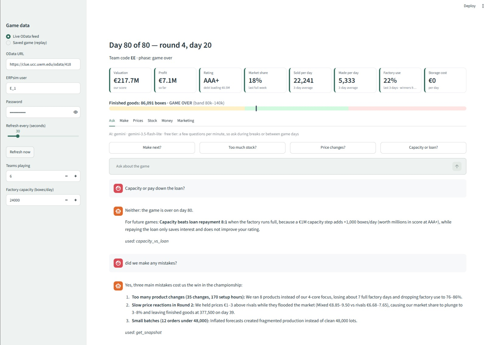

# ERPsim Co-pilot

**A live AI advisor for the SAP ERPsim Manufacturing (muesli) game.** It reads your game's OData feed and tells you
what to make next, how much, and what to charge, in plain words, with the exact numbers to type into SAP.



> "What should we produce next, and how much?" · "We have too much stock: what about prices?" · "Capacity or pay down the loan?"

It **advises only**: it never logs into SAP or changes anything. Your team types every action.
**Check with your instructor that an advisory tool is allowed before using it in a competition.**

---

## What it does

| Part | What you get |
|---|---|
| **Live numbers** | Valuation, profit, rating, market share, sold vs made per day, factory use, storage cost, refreshed every 15–120 s. |
| **Finished-goods gauge** | Total boxes against a healthy band (80k–140k). Switches to "will it sell out by day 80?" in the last days. |
| **Make tab** | Next product to convert (CO41), the MD61 forecast number that gives whole 48,000 batches, materials check, **production brake** when stock piles up. |
| **Prices tab** | Stock-aware price moves sized against rivals, with the new price for each channel (10 / 12 / 14). **Undercut alarm** when rivals are €1+ cheaper. |
| **Money tab** | Buying capacity vs paying down the loan, in profit and score terms. |
| **Marketing tab** | Which regions moved week to week, and how to test marketing properly. |
| **Ask tab** | Chat with an AI (Google Gemini, free tier) that reads all of the above plus **your team's own memory**. |
| **Replay** | Load a saved game and step through it day by day to practise or review. |

---

## What you need

- A **Windows or Mac laptop** and about 20 minutes.
- **Python 3.12** (see the warning below).
- A **free Google Gemini API key** (only for the Ask tab; everything else works without it).
- Your **ERPsim login** and the game's **OData URL** (`https://<server>/odata/<client>`, client number from your instructor).
- Your team's **strategy notes and past games** (you build these yourselves, see [Your memory](#your-memory-the-part-that-makes-it-yours)).

> ⚠️ **Use Python 3.12, not the newest version.** Brand-new Python versions (3.14, 3.15…) may not have ready-made
> versions of the add-ons yet. You then get `Failed building wheel for pyyaml` /
> `Microsoft Visual C++ 14.0 or greater is required`. Install 3.12 alongside and use `py -3.12` (step 4).
>
> ⚠️ **Don't put the folder on Google Drive, OneDrive or Dropbox.** The setup creates thousands of small files and the
> sync locks them. Use a normal folder like `C:\erpsim-copilot` or `Documents\erpsim-copilot` (not synced).

---

## Setup (Windows, step by step)

Each step says what it does, so you're not running commands blindly.

**1. Install Python 3.12.** python.org → Downloads → *Looking for a specific release?* → newest **3.12** → Windows
installer (64-bit). On the first screen **tick "Add python.exe to PATH"**, then Install.
*Installs Python; PATH lets you type `python` in any terminal.*

**2. Download this project.** On this page: green **Code** button → **Download ZIP**. Unzip it to `C:\erpsim-copilot`.

**3. Open a terminal in that folder.** Open the folder in File Explorer, click the address bar, type `cmd`, press Enter.
*A terminal is a window where you type commands. Opening it this way makes it work in this folder.*
Use **Command Prompt** (cmd), not PowerShell: PowerShell often blocks step 4's activate command.

**4. Create a private toolbox for this project (once):**
```
py -3.12 -m venv .venv
.venv\Scripts\activate
python --version
```
*Makes a separate copy of Python (`.venv`) just for this project, and switches to it. You'll see `(.venv)` at the start
of the line. The last line should say `Python 3.12.x`.* Run the `activate` line every time you open a new terminal.

**5. Install the add-ons (once):**
```
pip install -r requirements.txt
```
*`requirements.txt` is the shopping list (Excel reading, the data feed, the web page, Google's AI library). `pip`
downloads them into your toolbox. Ignore the "new pip version" notice.*

**6. Your settings (once):**
```
copy .env.example .env
copy config.example.yaml config.yaml
notepad .env
```
In Notepad fill in your Gemini key (step 7), the OData URL, your ERPsim user and password. Save and close.
*`.env` holds your secrets, on your laptop only. Never upload or share it.*
Then `notepad config.yaml` to set your products, mix and recipes (or use the AI prompts in [docs/AI_PROMPTS.md](docs/AI_PROMPTS.md)).

**7. Get the free Gemini key.** Go to **https://aistudio.google.com**, sign in with a Google account, click
**Get API key → Create API key**, copy it, and paste it after `GEMINI_API_KEY=` in `.env`. No credit card needed.

**8. Add your memory and history** (next section).

**9. Test without AI** (replays a saved game at day 30 and prints all advice):
```
python -m copilot.cli --replay history\YOUR_GAME.xlsx --day 30 --dry-run
```

**10. Start the app:**
```
streamlit run app.py
```
*Opens a web page at `http://localhost:8501`. "localhost" means your own laptop; nothing is online.*
Stop it with **Ctrl + C** in the terminal.

**Every time after that:** open the folder → `cmd` in the address bar → `.venv\Scripts\activate` → `streamlit run app.py`.

**Mac:** install Python 3.12 from python.org, then in Terminal: `cd` to the folder, `python3.12 -m venv .venv`,
`source .venv/bin/activate`, `pip install -r requirements.txt`, `cp .env.example .env`, `cp config.example.yaml config.yaml`,
`open -e .env`, `streamlit run app.py`.

---

## Your memory: the part that makes it yours

The co-pilot ships **without** anyone's strategy. Each team brings its own. This is what makes it competitive.

```
erpsim-copilot\
├── .env                     your secrets (key, login)          ← never share
├── config.yaml              your products, mix, recipes, costs ← never share
├── memory\
│   ├── templates\           empty examples to copy
│   └── private\             YOUR files: strategy.md, lessons.md, game_rules.md
└── history\                 YOUR past games: one .xlsx per game
```

**Memory (`memory\private\`)**
1. Copy the templates: `copy memory\templates\*.md memory\private\`
2. Fill them in: **strategy.md** (your playbook), **lessons.md** (what went right and wrong, with numbers),
   **game_rules.md** (facts you've checked: capacity, costs, score formula…).
   The fastest way is an AI chat; ready-made prompts are in **[docs/AI_PROMPTS.md](docs/AI_PROMPTS.md)**.

Good to know:
- Only **`.md` and `.txt`** files are read (not PDF, Word or Excel).
- About **40,000 characters in total** (15–20 pages); anything beyond is cut off. Shorter is faster.
- It's sent with **every question**: keep it to rules and lessons that matter.
- It guides the **chat**. The numbers on the tabs come from the engine and `config.yaml`.
- After editing, **refresh the browser page** so a new chat loads it.
- **No passwords or personal details.** On the free tier Google may use what you send to improve its products.

**History (`history\`)**
- At the end of a live game, click **Save this game to history** in the sidebar. It saves every table to
  `history\<name>.xlsx`, which the co-pilot summarises and remembers (result, profit by round, prices, idle days,
  small orders, leftovers). You can also replay it in the app.
- Older games: any workbook with one sheet per OData table works (sheet names `Company_Valuation`, `Sales`,
  `Inventory`, `Production`, `Production_Orders`, `Purchase_Orders`, `Market`, `Current_Pricing_Conditions`,
  `Independent_Requirements`), e.g. one you built in Excel with Data → Get Data → From OData Feed.

---

## Known issues and fixes

| You see | Why | Fix |
|---|---|---|
| `Failed building wheel for pyyaml` · `Microsoft Visual C++ 14.0 is required` | Python too new for the add-ons | Install **Python 3.12**, delete `.venv`, `py -3.12 -m venv .venv` |
| `'python' is not recognized` | Python not on PATH | Re-run the installer → Modify → tick "Add to PATH" |
| `running scripts is disabled on this system` | PowerShell blocks activate | Use **Command Prompt** (type `cmd` in the address bar) |
| Odd file errors, slow install | Folder on Google Drive / OneDrive | Move the folder to a local, non-synced folder |
| "The free AI limit for this minute is used up" | Gemini free tier: a few requests per minute | Wait a minute; ask during breaks |
| AI error mentioning the model "not found" | Google renamed its models | Pick a free Flash/Flash-Lite model in AI Studio; set `COPILOT_MODEL=` in `.env` |
| Prices tab says "Costs from: config.yaml" | Feed has no supplier-price table | Put your cost per box in `config.yaml` |

More detail: **[docs/TROUBLESHOOTING.md](docs/TROUBLESHOOTING.md)**.

---

## How it decides (short version)

- **Next batch:** the product that runs out soonest at its real sales pace, if its materials are in.
- **Forecast (MD61):** stock + queued + whole 48,000 batches, so MRP only creates full batches.
- **Prices:** raise when a product sells faster than its share, never with 7+ days of stock; cut when it's slow while
  properly in stock, unsold, or piling up; never cut a product that's slow only because it's nearly out.
  Moves €0.25–€1.00, capped by floor/ceiling and €1 above rivals.
- **Undercut alarm:** rivals €1+ cheaper and our stock rising → cut every day until within €0.50.
- **Production brake:** over 250,000 boxes with every product above 10 days of stock → pause the line.
- **Costs:** your recipe × the game's own supplier prices when the feed has them.
- **Warnings:** more than 5 products, DC10 above DC12, prices below the floor, game over on day 80.

All thresholds live in `copilot/config.py` (`Rules`) and can be changed in `config.yaml`.

---

## Privacy and fair play

- Secrets stay in `.env` on your laptop. `.env`, `config.yaml`, `memory/private/` and `history/` are ignored by git.
- The free Gemini tier may use what you send (questions, game numbers, memory) to improve Google's products.
- Advisory only. Ask your instructor before using it in a graded or competitive game.

## Project layout

```
app.py                web app (Streamlit)
copilot/odata.py      live feed + saved workbooks
copilot/model.py      today's numbers per product and material
copilot/engine.py     the decision rules (the tabs and the AI's tools)
copilot/elasticity.py how sales react to price, learned from your game
copilot/agent.py      AI chat (Gemini by default, Claude optional)
copilot/memory.py     your notes + past-game summaries
copilot/cli.py        terminal use and replay
docs/                 troubleshooting and AI prompts
tests/                rule tests (pytest -q)
```

## Licence

MIT. Not affiliated with SAP, ERPsim or HEC Montréal. The co-pilot can be wrong; the people at the keyboard make the calls.
Built by Mark Fourmanovskis, Seneca Polytechnic (Supply Chain Management), 2026.
